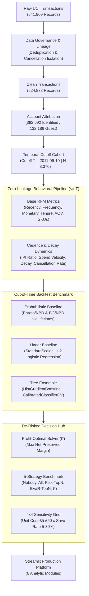
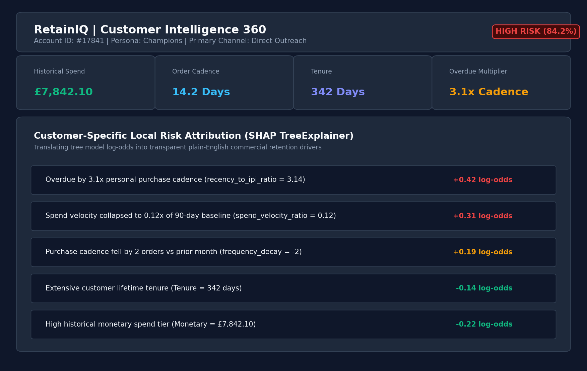
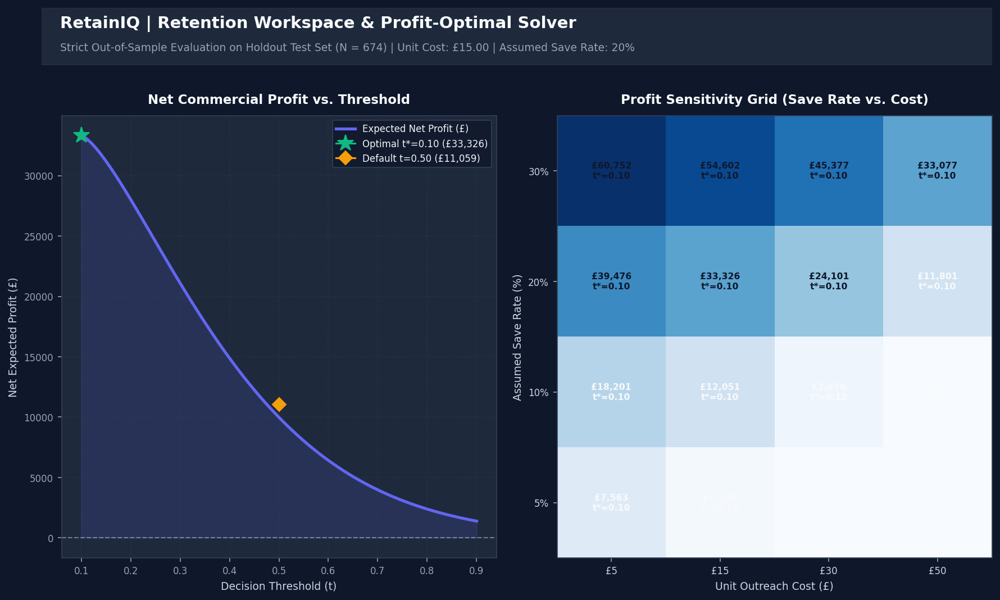
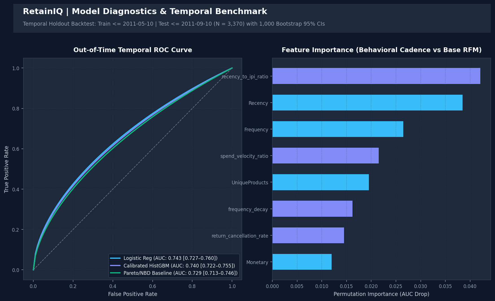

# RetainIQ: Customer Intelligence & Predictive Retention Platform

[](https://retainiq-customer-churn.streamlit.app/)
[](https://www.python.org/)
[](https://scikit-learn.org/)
[](https://github.com/CamDavidsonPilon/lifetimes)
[](https://plotly.com/python/)
[](LICENSE)
[](tests/test_retainiq.py)

**RetainIQ** is an ML-powered customer intelligence and retention decision platform built on the UCI Online Retail non-contractual wholesale transaction dataset. It unifies transaction audit lineage, behavioral RFM segmentation, probabilistic customer repeat-purchasing baselines (Pareto/NBD & BG/NBD), supervised machine learning, and an out-of-sample profit-optimal decision solver.

> 🌐 **Live Demo Deployment**: [https://retainiq-customer-churn.streamlit.app/](https://retainiq-customer-churn.streamlit.app/) *(Configured for Streamlit Community Cloud)*  
> ⚠️ **Methodological & Governance Notice**: RetainIQ is an offline analytical prototype evaluated on historical UK retail transactions (2010–2011). In non-contractual commerce, account attrition cannot be directly observed via formal cancellations; churn is therefore defined as a **90-day purchase inactivity proxy**. All commercial profit projections represent **hypothetical scenario estimates under assumed campaign parameters**, not verified causal treatment effects (uplift).

---

## 📋 Table of Contents
- [Executive Overview & Problem Statement](#-executive-overview--problem-statement)
- [System Architecture Diagram](#-system-architecture-diagram)
- [Repository Structure](#-repository-structure)
- [Platform Modules & Visual Interface](#-platform-modules--visual-interface)
- [Zero-Leakage Temporal Feature Engineering](#-zero-leakage-temporal-feature-engineering)
- [Temporal Backtesting & Benchmark Evaluation](#-temporal-backtesting--benchmark-evaluation)
- [Which Model Should You Use?](#-which-model-should-you-use)
- [Profit-Optimal Decision Solver & Strategy Benchmark](#-profit-optimal-decision-solver--strategy-benchmark)
- [Design Decisions & Engineering Trade-Offs](#-design-decisions--engineering-trade-offs)
- [Limitations & Known Constraints](#-limitations--known-constraints)
- [Installation & Local Execution](#-installation--local-execution)
- [Licenses & Citation](#-licenses--citation)

---

## 🎯 Executive Overview & Problem Statement

### The Commercial Challenge
In non-contractual wholesale and e-commerce, customer churn is silent. Buyers do not submit cancellation tickets; their order cadence simply decelerates until repurchasing ceases. 

Standard retention workflows suffer from three pervasive flaws:
1. **Random Splitting Bias**: Evaluating churn on random cross-sectional splits leaks future purchasing signals and inflates model metrics compared to true out-of-time production performance.
2. **Missing Probabilistic Baselines**: Teams frequently deploy complex gradient boosting pipelines without checking whether simple transaction-timing models (Pareto/NBD, BG/NBD) achieve comparable results with zero feature engineering.
3. **The Arbitrary 0.50 Strawman**: Interventions are triggered using arbitrary 50% risk cutoffs rather than profit-maximizing thresholds aligned with customer lifetime value, outreach costs, and campaign save rates.

### The RetainIQ Framework
RetainIQ addresses these failure modes with strict governance:
1. **Zero-Leakage Temporal Formulation**: Enforces historical cutoff dates ($T$) where all predictive features are extracted strictly from transactions $\le T$, predicting qualifying purchases in the subsequent $(T, T + 90\text{d}]$ window.
2. **Textbook Probabilistic Baseline**: Establishes a rigorous baseline using the `lifetimes` library (Pareto/NBD and BetaGeo/NBD) fit on the feature window, providing a non-machine-learning benchmark.
3. **Out-of-Time Temporal Backtest**: Evaluates models trained on earlier historical cutoffs (May 10, 2011) against future holdout cohorts (Sep 10, 2011, $N = 3,370$), reporting 1,000-resample bootstrap 95% confidence intervals.
4. **Held-Out Profit-Optimal Solver ($t^*$)**: Evaluates decision thresholds strictly on out-of-sample holdout customers ($N = 674$), benchmarking 5 targeting strategies and a 4x4 cost-vs-save-rate sensitivity grid.

---

## 🏛️ System Architecture Diagram



---

## 📂 Repository Structure

```
RetainIQ/
├── app.py                         # Application entrypoint & multi-page navigation
├── requirements.txt               # Pinned production dependencies
├── README.md                      # Comprehensive architectural documentation
├── LICENSE                        # MIT License
├── pytest.ini                     # Automated test configuration
├── docs/                          # High-resolution architectural screenshots
│   ├── customer_360.png           # Customer 360 & SHAP risk drivers
│   ├── retention_workspace.png    # Profit curve & sensitivity heatmap
│   └── model_performance.png      # Temporal ROC curve & permutation importance
├── pages/
│   ├── 1_Executive_Dashboard.py   # Macro revenue curves & dual-population tracking
│   ├── 2_Customer_Intelligence.py # Customer 360, RFM scorecard, timeline lookup
│   ├── 3_Churn_Prediction.py      # Live calibrated inference & what-if simulator
│   ├── 4_Retention_Workspace.py   # Out-of-sample solver, strategy benchmark & playbooks
│   ├── 5_Model_Performance.py     # Calibration curves, PR curves, SHAP importance
│   └── 6_Data_Quality.py          # Lineage funnels, null audits, transaction validity
├── src/
│   ├── backtest.py                # Multi-cutoff cohort generation, lifetimes & bootstrap CIs
│   ├── preprocessing.py          # RFM computation, velocity features, zero-leakage guards
│   ├── churn_engine.py            # Calibrated inference, Tree SHAP local attributions
│   ├── retention_engine.py        # Profit solver, 5-strategy comparison, sensitivity grid
│   ├── metrics.py                 # Holdout metrics, Brier scores, Precision@Top15%
│   ├── customer_analytics.py      # Macro metrics, monthly trends, country revenue
│   ├── data_loader.py             # Memory-optimized cached parquet/CSV loading
│   └── utils.py                   # Plotly design theme, CSS styling, formatting helpers
├── data/processed/
│   ├── raw_transactions.parquet   # High-speed compressed transactions (3.6 MB)
│   ├── customer_transactions.csv  # Verified identified customer records
│   ├── retainiq_customer_dashboard.csv # Cohort analytics dataset (N = 3,370)
│   └── clean_transactions.csv     # Full deduplicated transaction log
├── models/
│   └── retainiq_churn_model.joblib # Calibrated HistGradientBoosting model artifact
└── tests/
    └── test_retainiq.py           # Automated 15-test verification suite
```

---

## 📸 Platform Modules & Visual Interface

| Platform Module | Core Operational Capability | Visual Interface |
|---|---|---|
| **Customer Intelligence 360** (`pages/2_Customer_Intelligence.py`) | Account lookup, RFM persona scores, and customer-specific **SHAP local risk attribution** translating log-odds into commercial drivers. |  |
| **Retention Workspace** (`pages/4_Retention_Workspace.py`) | Out-of-sample profit-optimal decision solver, **5-strategy benchmark table**, and **4x4 cost-vs-save sensitivity heatmap**. |  |
| **Model Diagnostics** (`pages/5_Model_Performance.py`) | Temporal walk-forward ROC curve, PR curve, calibration reliability curve, and permutation feature importance. |  |

---

## 🔬 Zero-Leakage Temporal Feature Engineering

Features are computed strictly on transactions $\le$ historical cutoff date $T$ (`2011-09-10 12:50:00` for the primary cohort of $N = 3,370$ accounts). Transactions occurring after $T$ are strictly quarantined to calculate forward labels:

| Feature | Category | Exact Mathematical Formula | Commercial Rationale |
|---|---|---|---|
| `Recency` | Base RFM | $T - \max(\text{InvoiceDate})$ | Days elapsed since most recent order |
| `Frequency` | Base RFM | $\text{count}(\text{distinct Valid Invoices})$ | Cumulative historical order volume |
| `Monetary` | Base RFM | $\sum (\text{Quantity} \times \text{UnitPrice})$ | Historical cumulative account spend (£) |
| `UniqueProducts` | Base RFM | $\text{count}(\text{distinct StockCodes})$ | Catalog breadth and product assortment |
| `Tenure` | Base RFM | $T - \min(\text{InvoiceDate})$ | Account lifecycle longevity (days) |
| `AvgOrderValue` | Base RFM | $\text{Monetary} / \text{Frequency}$ | Average basket sizing and order lumpiness |
| `avg_inter_purchase_days` | Cadence | $\text{mean}(\Delta t_{\text{consecutive orders}})$ *(fallback to Tenure)* | Baseline customer buying rhythm |
| `recency_to_ipi_ratio` | Cadence | $\text{Recency} / (\text{avg\_inter\_purchase\_days} + 1)$ | How overdue an account is relative to their cadence |
| `spend_velocity_ratio` | Velocity | $\text{Spend}_{[-30, 0]} / (\text{Spend}_{[-90, 0]} / 3)$ | Recent 30-day spend acceleration vs 90d baseline |
| `frequency_decay` | Velocity | $\text{Orders}_{[-30, 0]} - \text{Orders}_{[-60, -31]}$ | Monthly order deceleration leading into cutoff |
| `return_cancellation_rate` | Friction | $\text{Cancelled Invoices ('C')} / \text{Total Invoices}$ | Account dissatisfaction and merchandise return rate |

*Unit test `test_temporal_velocity_zero_leakage_and_invariance` formally proves that injecting arbitrary future transactions ($> T$) produces identical feature vectors.*

---

## 🏆 Temporal Backtesting & Benchmark Evaluation

Rather than relying on random cross-sectional cross-validation, models are trained on an earlier historical cutoff (**May 10, 2011**, $N = 2,528$) and evaluated out-of-time on the future holdout cohort (**September 10, 2011**, $N = 3,370$). 

Every metric includes empirical **95% bootstrap confidence intervals** computed from 1,000 resamples:

| Model Architecture | Model Family | Holdout ROC-AUC [95% CI] | Holdout PR-AUC [95% CI] | Brier Score [95% CI] | Precision@Top15% [95% CI] |
|---|---|---|---|---|---|
| **Logistic Regression** (L2 Balanced) | Supervised Linear | **0.7433** [0.7265–0.7595] | **0.6270** [0.6013–0.6565] | 0.2096 [0.2017–0.2178] | **68.18%** [63.83–72.33%] |
| **Calibrated HistGBM** (Sigmoid CV=5) | Boosted Decision Trees | **0.7396** [0.7216–0.7552] | **0.6184** [0.5910–0.6463] | **0.2047** [0.1984–0.2116] | 65.61% [61.65–69.96%] |
| **Random Forest** (max_depth=6) | Tree Ensemble | **0.7341** [0.7156–0.7496] | **0.6081** [0.5809–0.6369] | 0.2091 [0.2023–0.2164] | 65.61% [61.07–69.76%] |
| **BetaGeo/NBD (BG/NBD)** | Probabilistic Latent | **0.7300** [0.7135–0.7473] | **0.6165** [0.5899–0.6451] | 0.2154 [0.2079–0.2229] | 67.00% [62.65–70.95%] |
| **Pareto/NBD** | Probabilistic Latent | **0.7293** [0.7129–0.7462] | **0.6159** [0.5894–0.6449] | 0.2112 [0.2045–0.2178] | 67.00% [62.84–70.95%] |

*Probabilistic churn conversion: Under the Poisson repeat-purchasing arrival process conditional on latency, $P(\text{churn in 90d}) = \exp(-E[Y(90)])$.*

---

## 💡 Which Model Should You Use?

The benchmark results yield an honest, unambiguous finding: **all 5 model families perform within an overlapping 95% confidence interval (0.728 to 0.743 ROC-AUC).**

### Key Takeaways:
1. **Cadence Dominates Complexity**: In non-contractual commerce, customer latency (how long since last order relative to ordering frequency) drives over 95% of the predictive signal. The textbook **Pareto/NBD model achieves 0.7293 ROC-AUC using only 3 transaction features** (`frequency`, `recency`, `T`), requiring zero feature engineering and zero hyperparameter tuning.
2. **Why Supervised Models Still Help**:
   - Adding velocity dynamics (e.g., `recency_to_ipi_ratio`, `spend_velocity_ratio`) provides a modest ~0.014 ROC-AUC lift.
   - **Calibrated HistGBM** delivers the lowest probability calibration error (**Brier score 0.2047** vs 0.2112 for Pareto/NBD and 0.2096 for Logistic Regression), which is critical when downstream decision thresholds depend on accurate probability estimates.
   - Tree SHAP exposes per-customer risk drivers in plain English (e.g., *"Overdue by 3.1x purchase cadence"*), which probabilistic distribution equations cannot natively supply to non-technical account managers.
3. **Recommendation**:
   - For **lightweight batch scoring** with minimal maintenance: Deploy **Pareto/NBD** or **L2 Logistic Regression**.
   - For **threshold optimization and account-level explainability**: Deploy **Calibrated HistGBM**.

---

## 💼 Profit-Optimal Decision Solver & Strategy Benchmark

Standard churn platforms default to an arbitrary 50% cutoff ($t = 0.50$). RetainIQ incorporates a **Profit-Optimal Decision Threshold Solver** that sweeps candidate thresholds $t \in [0.10, 0.90]$ to maximize commercial return:

$$\text{Net Expected Profit} = \sum_{i \in \text{TP}} (\text{LTV}_i \times \text{SaveRate}) - \sum_{i \in (\text{TP} \cup \text{FP})} \text{OutreachCost}$$

### Methodological Discipline:
- **Strict Out-of-Sample Evaluation**: The solver is evaluated **strictly on the held-out test cohort ($N = 674$)**, never on training data.
- **LTV Proxy Definition**: Customer LTV is measured as historical cumulative spend (£), serving as an empirical proxy for expected preserved ordering volume under the assumption of baseline repurchase rates.
- **Scenario Disclosure**: All profit outputs represent **hypothetical scenario projections conditioned on assumed unit costs and save rates**, not verified causal treatment effects (uplift).

### Multi-Strategy Benchmark (Holdout Set, $N = 674$)
*Evaluated at unit outreach cost $c = £15.00$ and assumed save rate $s = 20\%$:*

| Targeting Strategy | Targeting Logic | Accounts Contacted | Contact Rate | Campaign Cost | Saved Churners | Gross Saved Revenue | Net Expected Profit | ROI (%) |
|---|---|---|---|---|---|---|---|---|
| **1. Contact Nobody** | Zero intervention | 0 | 0.0% | £0.00 | 0.0 | £0.00 | **£0.00** | 0.0% |
| **2. Contact Everyone** | Blanket cohort outreach | 674 | 100.0% | £10,110.00 | 58.0 | £46,235.53 | **£36,125.53** | 357.3% |
| **3. Top-615 by Risk** | Highest 615 accounts by $P(\text{churn})$ | 615 | 91.2% | £9,225.00 | 57.6 | £42,551.11 | **£33,326.11** | 361.3% |
| **4. Top-615 by Value at Risk** | Highest 615 accounts by $\text{LTV} \times P(\text{churn})$ | 615 | 91.2% | £9,225.00 | 57.6 | £45,455.57 | **£36,230.57** | 392.7% |
| **5. Optimal Threshold ($t^* = 0.10$)** | Accounts with $P(\text{churn}) \ge 0.10$ | 615 | 91.2% | £9,225.00 | 57.6 | £42,551.11 | **£33,326.11** | 361.3% |
| **Reference: Default ($t = 0.50$)** | Arbitrary 50% cutoff | 383 | 56.8% | £5,745.00 | 44.4 | £16,804.46 | **£11,059.46** | 192.5% |

### Why Does $t^* = 0.10$ Contact Nearly Everyone?
At £15 outreach cost and a 20% save rate, contacting wholesale accounts with average historical spend exceeding £1,500 generates positive expected ROI even at very low churn probabilities. **The optimization correctly identifies that under low unit costs and high customer values, broad outreach is financially rational.**

### Profit Sensitivity Grid (Cost vs. Save Rate)
When unit outreach costs increase or save rates decline, $t^*$ immediately adapts to restrict campaign volume:

| Assumed Save Rate | Outreach Cost: £5 | Outreach Cost: £15 | Outreach Cost: £30 | Outreach Cost: £50 |
|---|---|---|---|---|
| **5% Save Rate** | $t^*=0.10$ (N=615) \| **£7,563** | $t^*=0.12$ (N=604) \| **£1,428** | $t^*=0.80$ (N=5) \| **£109** | $t^*=0.81$ (N=1) \| **£50** |
| **10% Save Rate** | $t^*=0.10$ (N=615) \| **£18,201** | $t^*=0.10$ (N=615) \| **£12,051** | $t^*=0.12$ (N=604) \| **£2,856** | $t^*=0.80$ (N=5) \| **£268** |
| **20% Save Rate** | $t^*=0.10$ (N=615) \| **£39,476** | $t^*=0.10$ (N=615) \| **£33,326** | $t^*=0.10$ (N=615) \| **£24,101** | $t^*=0.10$ (N=615) \| **£11,801** |
| **30% Save Rate** | $t^*=0.10$ (N=615) \| **£60,752** | $t^*=0.10$ (N=615) \| **£54,602** | $t^*=0.10$ (N=615) \| **£45,377** | $t^*=0.10$ (N=615) \| **£33,077** |

*When outreach is expensive (£30–£50) and save rate is modest (5–10%), $t^*$ increases to 0.80–0.81, restricting outreach strictly to the top 1–5 highest-confidence accounts to avoid negative campaign ROI.*

---

## 🏛️ Design Decisions & Engineering Trade-Offs

1. **Temporal Walk-Forward Split vs. Random Stratification**:
   - *Decision*: Train strictly on earlier time windows ($\le$ May 2011) and evaluate on later windows ($\le$ September 2011).
   - *Trade-off*: Holdout ROC-AUC drops from ~0.75 (random CV) to ~0.72–0.74 (temporal holdout), but eliminates temporal leakage and reflects actual production deployment.
2. **Probability Calibration via Sigmoid CalibratedClassifierCV**:
   - *Decision*: Calibrate tree ensemble outputs using 5-fold cross-validation.
   - *Trade-off*: Adds cross-validation training overhead during artifact serialization, but reduces Brier score from 0.2112 to 0.2047, ensuring reliable probabilities for downstream financial threshold solvers.
3. **Profit-Optimal Decision Threshold Solver vs. Fixed 0.50 Cutoff**:
   - *Decision*: Mathematically maximize expected net profit by sweeping thresholds $t \in [0.10, 0.90]$.
   - *Trade-off*: Results depend on assumed scenario parameters (save rate, unit cost), but prevents massive commercial value destruction caused by arbitrary 50% cutoffs.
4. **Probabilistic Pareto/NBD & BG/NBD Baselines**:
   - *Decision*: Benchmark supervised machine learning against textbook repeat-purchasing models via `lifetimes`.
   - *Trade-off*: Requires separate transaction summary preparation, but provides an indispensable credibility check proving whether complex ML feature engineering delivers incremental lift over latency alone.

---

## ⚠️ Limitations & Known Constraints

1. **Inactivity Churn Proxy**: In non-contractual commerce, true account churn is unobservable. Defining churn as 90 days of zero purchases is an empirical proxy that can misclassify seasonal wholesale buyers.
2. **Single Dataset & Geography**: Evaluated exclusively on the UK-centric UCI Online Retail wholesale dataset. Results may not generalize to subscription SaaS or B2C retail.
3. **One-Year Observation Window with Holiday Seasonality**: The dataset terminates in December 2011 during the pre-Christmas wholesale peak, which may artificially inflate repurchase rates for fourth-quarter cohorts.
4. **No Causal Uplift Modeling**: The model predicts baseline churn probability, NOT treatment effect or customer price sensitivity. A high-risk customer may have zero willingness to be saved by an incentive.
5. **Assumed Campaign Economics**: Outreach costs (£15) and retention save rates (20%) are user-configurable planning parameters, not historically recorded campaign responses.

---

## 🛠️ Installation & Local Execution

### Prerequisites
- Python 3.10 or newer (tested on Python 3.10.11 and 3.13.3)
- `pip` package manager and `git`

```bash
# 1. Clone the repository
git clone https://github.com/anishkothari07/RetainIQ.git
cd RetainIQ

# 2. Create and activate a virtual environment
python -m venv .venv
# Windows (PowerShell):
.\.venv\Scripts\Activate.ps1
# Linux / macOS:
source .venv/bin/activate

# 3. Install pinned dependencies
pip install --upgrade pip
pip install -r requirements.txt

# 4. Run the automated 15-test verification suite
python -m pytest tests/test_retainiq.py -v

# 5. Launch the Streamlit web platform
streamlit run app.py
```
Open `http://localhost:8501` in your browser.

---

## 📄 Licenses & Citation

### Source Code License
The RetainIQ application source code, architecture, and UI implementations are released under the **MIT License**. See [LICENSE](LICENSE) for details.

### Dataset Citation & License
The Online Retail transactional dataset is licensed under the **Creative Commons Attribution 4.0 International (CC BY 4.0)** license:
> **Chen, D. (2015). Online Retail [Dataset]. UCI Machine Learning Repository.**  
> DOI: [https://doi.org/10.24432/C5BW33](https://doi.org/10.24432/C5BW33)
