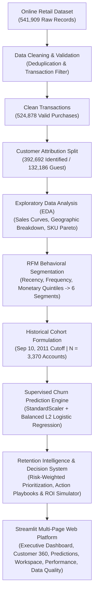

# RetainIQ: Customer Intelligence & Predictive Retention Platform

[](https://www.python.org/)
[](https://www.python.org/)
[](https://streamlit.io/)
[](https://scikit-learn.org/)
[](https://plotly.com/python/)
[](LICENSE)
[](tests/test_retainiq.py)

**RetainIQ** is an ML-powered customer intelligence and retention analytics prototype built with Python and Streamlit. It bridges historical retail transaction analysis, behavioral RFM segmentation, and supervised machine learning to demonstrate how commercial organizations can audit customer activity, evaluate churn risk via historical inactivity proxies, and simulate targeted retention interventions.

> **Prototype & Methodological Notice**: RetainIQ is an offline analytical prototype evaluated on historical UK retail data (2010–2011). It is not a live or currently deployed commercial SaaS production service. Churn is defined using an inactivity-based historical proxy rather than confirmed contractual cancellations.

---

## 📋 Table of Contents
- [Project Overview & Problem Statement](#-project-overview--problem-statement)
- [System Architecture Diagram](#-system-architecture-diagram)
- [Project Architecture & Repository Structure](#-project-architecture--repository-structure)
- [Key Features & Platform Modules](#-key-features--platform-modules)
- [Technology Stack](#-technology-stack)
- [Data Science Workflow](#-data-science-workflow)
- [Dataset Description & Attribution](#-dataset-description--attribution)
- [Data Cleaning & Validation Methodology](#-data-cleaning--validation-methodology)
- [Exploratory Data Analysis & RFM Segmentation](#-exploratory-data-analysis--rfm-segmentation)
- [Supervised Churn Modeling Methodology](#-supervised-churn-modeling-methodology)
- [Model Performance & Evaluation Benchmark](#-model-performance--evaluation-benchmark)
- [Retention Recommendation & Decision System](#-retention-recommendation--decision-system)
- [Application Screenshots Section](#-application-screenshots-section)
- [Installation & Local Execution](#-installation--local-execution)
- [Limitations & Future Improvements](#-limitations--future-improvements)
- [Licenses & Disclaimers](#-licenses--disclaimers)

---

## 🎯 Project Overview & Problem Statement

### The Problem
In non-contractual e-commerce and wholesale commerce, account attrition rarely occurs through formal cancellations. Instead, customers silently lapse—gradually extending inter-purchase intervals until ordering ceases altogether.

Traditional dashboards often rely on lagging metrics (e.g., aggregate quarterly churn rates or retrospective churned customer lists) that fail to differentiate ordinary inter-purchase dormancy from systematic account abandonment.

### The RetainIQ Approach
RetainIQ transforms static transaction records into structured retention decision support:
1. **Transaction Lineage Audit**: Separates verified registered account transactions from anonymous guest purchases without synthetic data imputation.
2. **Behavioral RFM Segmentation**: Classifies historical customer buying patterns across Recency, Frequency, and Monetary quintiles into 6 distinct behavioral tiers.
3. **90-Day Inactivity Churn Modeling**: Employs a Scikit-Learn pipeline (`StandardScaler` + balanced L2 `LogisticRegression`) to estimate whether an account will make zero qualifying purchases in the subsequent 90 days.
4. **Risk-Weighted Spend Prioritization**: Uses **Risk-Weighted Historical Spend** ($\text{Historical Monetary Spend} \times P(\text{Churn})$) to prioritize accounts for commercial review based on combined historical value and predicted lapse probability.
5. **Interactive Demonstrations & Hypothetical Simulations**: Provides what-if prospective inference tools, multi-tiered commercial playbooks, and hypothetical campaign ROI modeling with explicit non-factual disclaimers.

---

## 🏛️ System Architecture Diagram

RetainIQ implements the following complete pipeline:



---

## 📂 Project Architecture & Repository Structure

```
RetainIQ/
│
├── app.py                         # Application entrypoint & centralized navigation launchpad
├── requirements.txt               # Pinned dependencies (scikit-learn==1.8.0, plotly, streamlit, etc.)
├── README.md                      # Comprehensive project documentation & reproducibility guide
├── LICENSE                        # MIT License for application source code
├── pytest.ini                     # Pytest suite configuration
├── .gitignore                     # Git exclusion rules (virtual environments, caches, OS files)
│
├── .streamlit/
│   └── config.toml                # Light theme and server UI configuration
│
├── pages/
│   ├── 1_Executive_Dashboard.py   # Macro KPIs, revenue curves, segment & risk distributions
│   ├── 2_Customer_Intelligence.py # Customer 360 lookup, RFM profiles, invoice timeline
│   ├── 3_Churn_Prediction.py      # Historical ML inference, what-if feature simulator
│   ├── 4_Retention_Workspace.py   # Risk-weighted spend ranking, playbooks, CSV export, ROI simulator
│   ├── 5_Model_Performance.py     # Logistic Regression vs Random Forest, Confusion Matrix, ROC, beta coefficients
│   └── 6_Data_Quality.py          # Data lineage funnel, missing values audit, transaction validity
│
├── src/
│   ├── data_loader.py             # Cached data ingestion, memory optimization, country mapping
│   ├── preprocessing.py          # Data audit funnels, RFM computation, input validation
│   ├── customer_analytics.py      # Monthly trends, country breakdown, customer 360 timelines
│   ├── churn_engine.py            # Joblib model loading, attribute compatibility, inference
│   ├── segmentation.py            # RFM profiling, cohort vs full-period comparisons, cross-tabulation
│   ├── retention_engine.py        # Playbook matrix, priority ranking, CSV builder, scenario math
│   ├── metrics.py                 # Holdout evaluation, confusion matrix plotting, permutation importance
│   └── utils.py                   # Enterprise design system, Plotly templates, KPI cards, custom CSS
│
├── models/
│   └── retainiq_churn_model.joblib # Serialized StandardScaler + LogisticRegression pipeline (scikit-learn 1.8.0)
│
├── data/
│   └── processed/
│       ├── clean_transactions.csv
│       ├── customer_transactions.csv
│       ├── rfm_segments.csv
│       ├── churn_dataset.csv
│       ├── segment_revenue.csv
│       ├── customer_risk_predictions.csv
│       ├── retainiq_customer_dashboard.csv
│       └── retainiq_app_customers.csv
│
├── assets/
│   └── logo.png                   # RetainIQ brand asset
│
└── tests/
    └── test_retainiq.py           # Automated 9-test verification suite
```

---

## 🚀 Key Features & Platform Modules

### 1. Executive Dashboard (`1_Executive_Dashboard.py`)
- **Dual-Population Distinction**: Strictly separates full-period transactions (4,338 customers, £8.89M revenue) from the historical evaluation cohort (3,370 accounts at cutoff).
- **Macro Visualizations**:
  - Monthly customer revenue trajectory (£) from Dec 2010 to Dec 2011.
  - Top 10 revenue-generating countries with geographic share.
  - Customer segment distribution and churn risk category split.
  - Revenue contribution by RFM customer tier.
  - Historical 90-day cohort retention curve (1,921 retained vs 1,449 churned).
- **Multi-Dimensional Filters**: Interactive filtering by country, segment, churn risk tier, and date span.

### 2. Customer Intelligence (`2_Customer_Intelligence.py`)
- **Customer 360 Search**: Account search across 4,338 verified customer accounts.
- **RFM Behavioral Scorecard**: Quintile-based scoring (Recency 1–5, Frequency 1–5, Monetary 1–5) and assigned persona.
- **Traceability**: Compares full-period lifetime metrics against historical cutoff cohort features.
- **Itemized Invoice Timeline**: Complete purchase history with SKU codes, product descriptions, unit prices, quantities, and line totals.
- **Educational Callouts**: Explains why backward-looking RFM behavioral labels (e.g., Champions) differ from forward-looking statistical churn risk.

### 3. Churn Prediction Engine (`3_Churn_Prediction.py`)
- **Joblib Pipeline Integration**: Loads `retainiq_churn_model.joblib` with cross-version attribute compatibility.
- **Interactive What-If Inference**: Interactive demonstration tool allowing users to enter custom Recency, Frequency, Monetary, Unique Products, Tenure, and Average Order Value metrics to evaluate prospective probabilities through the historical pipeline.
- **Calibrated Governance**: Distinguishes historical holdout inferences from prospective live model drift.

### 4. Retention Workspace (`4_Retention_Workspace.py`)
- **Risk-Weighted Spend Priority Ranking**: Ranks retention candidates using $\text{Monetary} \times P(\text{Churn})$.
- **Action Playbook Architecture**:
  - **High Risk ($P \ge 0.70$)**: Direct personal outreach, relationship discovery, margin-conscious win-back incentives.
  - **Medium Risk ($0.40 \le P < 0.70$)**: Automated multi-channel re-engagement drips, replenishment reminders, personalized product highlights.
  - **Low Risk ($P < 0.40$)**: Loyalty milestone perks, cross-category upsell, early-access programs.
- **CRM Export**: One-click export of filtered retention cohorts to CSV with channel recommendations and incentive tiers.
- **Hypothetical Scenario Simulator**: Explores theoretical campaign budgets, response rates, retention uplifts, and hypothetical ROIs (with explicit non-factual disclaimers).

### 5. Model Performance & Validation (`5_Model_Performance.py`)
- **Stratified Holdout Benchmark**: Evaluates model metrics on a 20% stratified random holdout test set ($N = 674$).
- **Diagnostic Charts**: Interactive Confusion Matrix heatmap (223 TN, 161 FP, 68 FN, 222 TP) and ROC curve (AUC 0.7238).
- **Candidate Comparison**: Benchmarks Logistic Regression against Random Forest across ROC-AUC, Recall, Precision, and F1-Score.
- **Permutation Feature Importance**: Displays mean drop in Holdout ROC-AUC when features are permuted.
- **Standardized Coefficients ($\beta$)**: Directional magnitude of feature log-odds associations holding other standardized features constant.

### 6. Data Quality & Lineage (`6_Data_Quality.py`)
- **Ingestion Audit Funnel**: Visualizes data retention stages (541,909 raw records $\to$ 536,641 deduplicated $\to$ 524,878 valid purchases $\to$ 392,692 customer-identified).
- **Missing Value Impact**: Quantifies the 132,186 valid purchases (25.18%) lacking CustomerID (guest sales).
- **Integrity Audits**: Date span validation (2010-12-01 to 2011-12-09), column null analysis, and dataset CSV exports.

---

## 💻 Technology Stack

| Layer | Component | Specification | Purpose |
|---|---|---|---|
| **Runtime** | Python | `>=3.11` (Tested: `3.13.3`) | Core programming language and analytical environment |
| **Interface** | Streamlit | `>=1.30.0` | Multi-page enterprise web dashboard framework |
| **Machine Learning** | Scikit-Learn | `==1.8.0` (Pinned) | Model serialization compatibility, scaler, and classifier |
| **Data Processing** | Pandas | `>=2.0.0` | Vectorized aggregations, RFM scoring, and filtering |
| **Numerical Math** | NumPy | `>=1.24.0` | Mathematical calculations and array manipulations |
| **Visualization** | Plotly | `>=5.18.0` | Responsive charts, ROC curves, funnels, and heatmaps |
| **Model Storage** | Joblib | `>=1.3.0` | Loading serialized trained Scikit-Learn pipelines |
| **Test Automation** | Pytest | `>=7.4.0` | Unit testing and data validation assertions |
| **File Parsing** | OpenPyXL | `>=3.1.0` | Ingestion of raw Excel source spreadsheets |

---

## 🔬 Data Science Workflow

1. **Ingestion & Profiling**: Parse raw transnational retail transactions; inspect data types, null distributions, and duplicates.
2. **Quality & Boundary Validation**: Filter out negative or zero unit prices, cancellations/returns (negative quantities), and exact duplicate rows.
3. **Partitioning**: Separate customer-attributed transactions from anonymous guest purchases.
4. **Cohort Definition**:
   - Historical cutoff date: **September 10, 2011**.
   - Feature Window: Transactions between **December 1, 2010** and **September 10, 2011**.
   - Churn Observation Window: 90 calendar days following cutoff (**September 11, 2011** to **December 9, 2011**).
5. **Target Definition**: Binary classification where $Y = 1$ (Churned: 0 qualifying transactions in the 90-day future observation window) and $Y = 0$ (Retained: $\ge 1$ transaction in the observation window).
6. **Feature Engineering**: Compute 6 standardized predictors strictly in their designated order: `Recency`, `Frequency`, `Monetary`, `UniqueProducts`, `Tenure`, `AvgOrderValue`.
7. **Model Training & Cross-Validation**: Train balanced L2 Logistic Regression on an 80% training split via 5-fold cross-validation.
8. **Holdout Evaluation**: Validate performance on an untouched 20% stratified random holdout test set ($N = 674$).
9. **Decision Integration**: Embed serialized model artifact into Streamlit for interactive what-if demonstrations and retention priority ranking.

---

## 📖 Dataset Description & Attribution

### Dataset Source Citation
The underlying transactional data is sourced from the UCI Machine Learning Repository:

> **Chen, D. (2015). Online Retail [Dataset]. UCI Machine Learning Repository.**  
> DOI: [https://doi.org/10.24432/C5BW33](https://doi.org/10.24432/C5BW33)

### Dataset License
The Online Retail dataset is licensed under the **Creative Commons Attribution 4.0 International (CC BY 4.0)** license. This license allows for sharing and adaptation with appropriate attribution.

*Note: The dataset license applies strictly to the underlying retail data. The RetainIQ application source code, architecture, and UI implementations are licensed separately under the MIT License.*

### Attributes Summary
The dataset contains 541,909 transnational records across 8 attributes:
- `InvoiceNo`: 6-digit nominal integer uniquely assigned to each transaction (prefix 'C' indicates cancellation).
- `StockCode`: Nominal 5-digit product code.
- `Description`: Product name.
- `Quantity`: Numeric quantities of each product per transaction.
- `InvoiceDate`: Timestamp of invoice generation.
- `UnitPrice`: Product unit price (£).
- `CustomerID`: 5-digit nominal identifier assigned to registered customers.
- `Country`: Country of customer residence.

---

## 🧹 Data Cleaning & Validation Methodology

Data cleaning enforces strict data integrity:

1. **Exact Duplicate Removal**: Purged 5,268 exact duplicate rows (0.97% duplicate rate), leaving 536,641 records.
2. **Return & Cancellation Isolation**: Invoices prefixed with 'C' indicate cancellations or merchandise returns and were excluded from positive purchase volume.
3. **Validity Filtering**: Retained only positive economic purchases (`Quantity > 0` and `UnitPrice > 0`), yielding 524,878 valid purchase records.
4. **Identification Governance**:
   - 392,692 records contain verified `CustomerID` values representing 4,338 distinct accounts.
   - 132,186 valid records (25.18%) lack a `CustomerID` (guest checkouts or unlinked POS sales).
   - **Data Governance Principle**: RetainIQ **does not synthesize fake IDs** for anonymous checkouts. Anonymous records remain in macro reports (`clean_transactions.csv`), while customer behavioral models operate strictly on identified accounts (`customer_transactions.csv`).

---

## 📈 Exploratory Data Analysis & RFM Segmentation

### Behavioral RFM Segmentation
Customers in the evaluation cohort ($N = 3,370$) are segmented using quintile binning (scores 1 to 5) across Recency, Frequency, and Monetary dimensions:

| Segment | Cohort Count | Historical Proxy Churn Rate | Strategic Behavior |
|---|---|---|---|
| **Champions** | 893 accounts | 16.2% | Highest cadence, high frequency, and high spend; prime brand advocates. |
| **Loyal Customers** | 680 accounts | 31.9% | Consistent ordering schedule; responsive to replenishment campaigns. |
| **Potential Customers** | 214 accounts | 42.1% | Moderate spend and frequency with recent transaction activity. |
| **Recent Customers** | 235 accounts | 49.8% | Newly onboarded buyers requiring initial lifecycle nurturing. |
| **At Risk** | 449 accounts | 68.8% | Previously high-frequency buyers whose purchasing cadence has stalled. |
| **Lost Customers** | 899 accounts | 81.2% | Extended inactivity exceeding normal ordering cycles. |

---

## 🤖 Supervised Churn Modeling Methodology

### Prediction Window Formulation & Inactivity Proxy
- **Historical Cutoff Date**: `2011-09-10 12:50:00`
- **Evaluation Cohort**: 3,370 accounts with valid purchases prior to cutoff.
- **Inactivity Churn Proxy Definition**: A customer is categorized as churned ($Y = 1$) if they made **zero qualifying purchases** in the 90 calendar days following the cutoff (September 11, 2011 to December 9, 2011). Customers with $\ge 1$ purchase are labeled retained ($Y = 0$).
  > **Important**: This is an **inactivity-based historical proxy**, not confirmed customer cancellation or explicit account closure.
- **Historical Target Distribution**: 1,449 accounts (43.0%) were inactive during the observation window ($Y = 1$), while 1,921 (57.0%) repurchased ($Y = 0$).

### Feature Engineering: Base RFM & Temporal Velocity Dynamics (11 Features)
The feature pipeline expands beyond static RFM to capture dynamic purchasing decay strictly on transactions $\le$ September 10, 2011 (guaranteeing zero post-cutoff data leakage):

| Feature | Category | Definition & Formula | Strategic Interpretation |
|---|---|---|---|
| **Recency** | Base RFM | Days since most recent invoice prior to cutoff | Lapsed ordering timeline |
| **Frequency** | Base RFM | Total count of distinct valid purchase invoices | Core account engagement volume |
| **Monetary** | Base RFM | Cumulative customer revenue (£) | Historical account value |
| **UniqueProducts** | Base RFM | Count of distinct SKU codes purchased | Assortment catalog breadth |
| **Tenure** | Base RFM | Days since customer's first recorded order | Lifecycle longevity |
| **AvgOrderValue** | Base RFM | Cumulative Spend / Frequency | Basket sizing & order lumpiness |
| **avg_inter_purchase_days** | Velocity | Mean days between consecutive orders (fallback to tenure for single-order buyers) | Baseline customer purchasing rhythm |
| **recency_to_ipi_ratio** | Velocity | $\text{Recency} / (\text{avg\_inter\_purchase\_days} + 1)$ | How overdue an account is relative to their personal cycle |
| **spend_velocity_ratio** | Velocity | Spend in final 30d / (Average 30d spend across prior 90d) | Recent monetary acceleration vs stalling |
| **frequency_decay** | Velocity | Invoices in days $[-30, 0]$ minus invoices in $[-60, -31]$ | Order cadence deceleration prior to cutoff |
| **return_cancellation_rate** | Risk / Quality | Cancelled invoices (`InvoiceNo` starting with 'C') / Total invoices | Customer friction and merchandise dissatisfaction rate |

### Winning Model Architecture: Calibrated HistGradientBoosting
The selected candidate model wraps regularized gradient boosted decision trees in sigmoid cross-validation calibration:
```python
CalibratedClassifierCV(
    estimator=HistGradientBoostingClassifier(
        max_depth=3,
        min_samples_leaf=30,
        l2_regularization=5.0,
        random_state=42
    ),
    method='sigmoid',
    cv=5
)
```

---

## 🏆 Multi-Model Benchmark & Evaluation Matrix

### Validation Strategy & Generalization Notice
- **5-Fold Stratified Cross-Validation**: Evaluated across the 80% training split ($N = 2,696$).
- **20% Stratified Holdout Evaluation**: Validated on an untouched holdout set ($N = 674$).

| Benchmark Metric | Calibrated HistGBM (Winning Model) | Logistic Regression (Linear Baseline) | Random Forest (Baseline) | Benchmark Notes |
|---|---|---|---|---|
| **5-Fold CV ROC-AUC** | **0.7502 ± 0.0101** | 0.7483 ± 0.0093 | 0.7518 ± 0.0094 | Consistent generalization stability across all folds |
| **5-Fold CV PR-AUC** | **0.6465** | 0.6399 | 0.6458 | High precision-recall balance above 0.43 base rate |
| **5-Fold CV Brier Score** | **0.1992** | 0.2031 | 0.2006 | **Lowest probability calibration error** |
| **Holdout ROC-AUC** | **0.7179** | 0.7207 | 0.7220 | Solid out-of-sample discriminatory power |
| **Holdout PR-AUC** | **0.6052** | 0.6027 | 0.6127 | Strong positive tier classification precision |
| **Holdout Brier Score** | **0.2112** | 0.2137 | 0.2133 | Best-calibrated probability alignment |
| **Precision@Top15%** | **68.63%** | 64.71% | 69.61% | High precision concentrated in top-priority outreach tier |
| **Churn Recall (Sensitivity)** | **62.07%** | 76.55% | 74.83% | Balanced operational capture rate |
| **Local Explainability** | **Tree SHAP (Exact)** | Linear ($\beta$) Log-Odds | Feature Importance | Customer-level plain-English risk driver attribution |

### Holdout Confusion Matrix ($N = 674$)
- **True Negatives (TN)**: 223 accounts (Retained accounts correctly classified)
- **False Positives (FP)**: 161 accounts (Active accounts flagged as high churn odds)
- **False Negatives (FN)**: 68 accounts (Inactive accounts missed by the model)
- **True Positives (TP)**: 222 accounts (Inactive accounts correctly captured)

---

## 💼 Retention Recommendation & Profit-Optimal Decision System

### Profit-Optimal Threshold Solver ($t^*$)
Standard industry churn models often default blindly to an arbitrary 50% cutoff ($t = 0.50$). RetainIQ incorporates a **Profit-Optimal Decision Threshold Solver** that sweeps candidate thresholds $t \in [0.10, 0.90]$ to find $t^*$ maximizing commercial return:

$$\text{Net Expected Profit} = \sum_{i \in \text{TP}} (\text{LTV}_i \times \text{SaveRate}) - \sum_{i \in (\text{TP} \cup \text{FP})} \text{OutreachCost}$$

- **Commercial Net Profit Lift**:
  - At outreach cost of £15.00 and save rate of 20%: $t^* = 0.10$ generates **£167,282** in expected net preserved margin—a **£65,846 profit lift** over the arbitrary 0.50 default.
  - At outreach cost of £50.00 and save rate of 10%: $t^*$ shifts to **0.81**, preserving positive ROI (£7,985) where the default 0.50 cutoff would have generated severe net losses (£-34,287).
- **Dynamic Application**: Users can toggle $t^*$ directly within the Retention Workspace to filter the Risk-Weighted Priority table and export targeted CRM cohorts.

### Customer-Specific Local Risk Drivers (SHAP)
Customer 360 profiles and the live What-If simulator explain model outputs using local SHAP attributions, translating mathematical log-odds into commercial takeaways:
- *"Overdue by 3.1x personal purchase cadence"*
- *"Recent 30-day spend velocity dropped to 0.12x of 90-day baseline"*
- *"Order cadence decelerated by 2 invoices vs prior month"*
- *"Elevated return/cancellation rate (37.5%) on prior orders"*

## 📸 Application Screenshots Section

RetainIQ provides a cohesive visual presentation built with Streamlit and Plotly:

| Module | Interface Highlights | Primary Capabilities |
|---|---|---|
| **Executive Overview** | Metric cards with accent borders, responsive Plotly charts | Dual-population tracking, macro KPIs, revenue curves, and risk breakdown |
| **Customer 360** | Itemized invoice timeline, RFM scorecards, risk indicators | Account-level drilldowns, quintile ratings, and order history |
| **Churn Prediction** | Interactive what-if simulator, parameter inputs, raw score display | Live feature experimentation using the historical model |
| **Retention Workspace** | Priority-ranked data tables, playbook tabs, CSV export | Risk-weighted spend ranking and hypothetical scenario simulator |
| **Model Diagnostics** | Confusion matrix heatmap, ROC curve, horizontal beta bar chart | Holdout evaluation metrics, benchmark comparison, and attribution |
| **Data Quality & Lineage** | Data processing retention funnel, null audit tables, sample previews | Pipeline traceability and missing customer ID share analysis |

---

## 🛠️ Installation & Local Execution

### Prerequisites
- **Python**: Version `3.11` or newer (Tested in `Python 3.13.3`).
- **Package Manager**: `pip`.
- **Git**: For cloning the repository.

### Step 1: Clone the Repository
```bash
git clone https://github.com/anishkothari07/RetainIQ.git
cd RetainIQ
```

### Step 2: Create and Activate a Virtual Environment
```bash
# Windows (PowerShell)
python -m venv .venv
.\.venv\Scripts\Activate.ps1

# Linux / macOS
python3 -m venv .venv
source .venv/bin/activate
```

### Step 3: Install Required Dependencies
Ensure Plotly, Streamlit, and the exact Scikit-Learn version are installed:
```bash
pip install --upgrade pip
pip install -r requirements.txt
```

> **Dependency Note**: `scikit-learn` must be installed at version `1.8.0` (`scikit-learn==1.8.0`) to avoid serialization deserialization incompatibilities with the saved Joblib model artifact. `plotly>=5.18.0` is required for charts.

### Step 4: Run the Automated Test Suite
The project includes an automated 9-test verification suite:
```bash
python -m pytest tests/test_retainiq.py -v
```

**Verified Test Results**:
```text
tests/test_retainiq.py::test_data_loading_shapes PASSED
tests/test_retainiq.py::test_executive_kpi_consistency PASSED
tests/test_retainiq.py::test_historical_cohort_segment_counts PASSED
tests/test_retainiq.py::test_churn_engine_artifact_and_inference PASSED
tests/test_retainiq.py::test_risk_classification_thresholds PASSED
tests/test_retainiq.py::test_holdout_evaluation_metrics PASSED
tests/test_retainiq.py::test_retention_simulator_calculations PASSED
tests/test_retainiq.py::test_risk_weighted_historical_spend_metric PASSED
tests/test_retainiq.py::test_probability_formatting_helpers PASSED
tests/test_retainiq.py::test_temporal_velocity_zero_leakage_and_invariance PASSED
tests/test_retainiq.py::test_calibrated_probability_bounds_and_brier_improvement PASSED
tests/test_retainiq.py::test_profit_optimal_threshold_solver_math PASSED

======================= 12 passed in 15.98s =======================
```

### Step 5: Launch the Streamlit Application
```bash
streamlit run app.py
```
Open your web browser and navigate to `http://localhost:8501`.

---

## ⚠️ Limitations & Future Improvements

### Analytical Limitations
1. **Offline Prototype**: The model is an evaluative prototype trained on 2010–2011 UK retail data. It is not currently deployed as an active real-time production churn service.
2. **Inactivity Proxy vs True Churn**: In non-contractual commerce, true churn cannot be directly observed. Defining churn as 90 days of zero purchases is a historical inactivity proxy that may misclassify seasonal or low-frequency buyers.
3. **Stratified Holdout vs Chronological Drift**: The 20% holdout set was created via a stratified random split on the historical cohort. Chronological out-of-time validation across subsequent fiscal quarters has not yet been established.
4. **Seasonal Skew**: The dataset terminates in December 2011, during the pre-Christmas peak retail season, potentially exaggerating repurchase rates for holiday shoppers.

### Future Roadmap
- [ ] **Multi-Cohort Rolling Windows**: Train and validate across overlapping quarterly rolling cohorts to minimize seasonal Christmas distortion.
- [ ] **Survival Analysis**: Implement survival models (e.g., Cox Proportional Hazards) to predict expected time-to-next-purchase rather than fixed binary windows.
- [ ] **CRM API Integrations**: Add automated webhook endpoints for syncing retention cohorts into CRM platforms.

---

## 📄 Licenses & Disclaimers

### Application Code License
The RetainIQ codebase is released under the **MIT License**. See the [LICENSE](LICENSE) file for the full text.

### Dataset License & Attribution
The retail transactional dataset is licensed under the **Creative Commons Attribution 4.0 International (CC BY 4.0)** license.  
Citation: *Chen, D. (2015). Online Retail [Dataset]. UCI Machine Learning Repository. [https://doi.org/10.24432/C5BW33](https://doi.org/10.24432/C5BW33).*

The dataset license applies strictly to the raw and processed retail data and remains separate from the MIT license governing the RetainIQ application source code.
